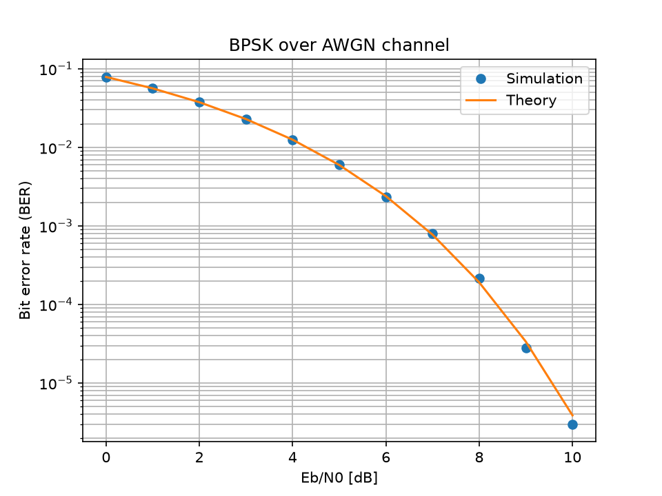
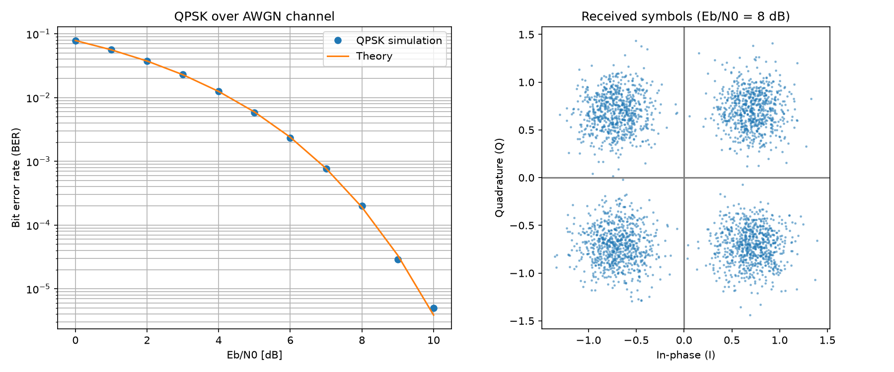
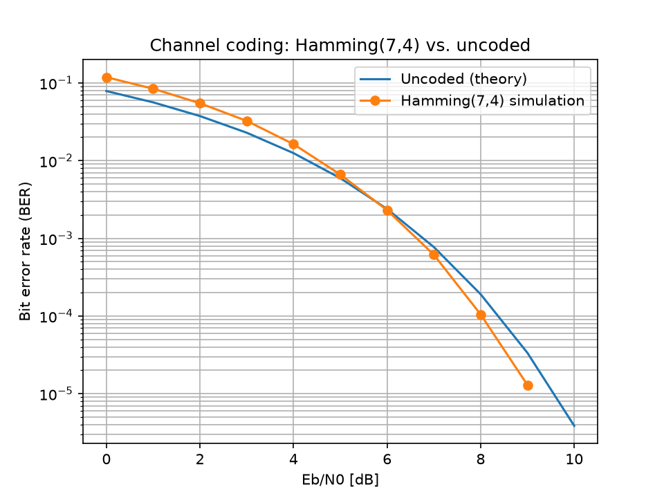
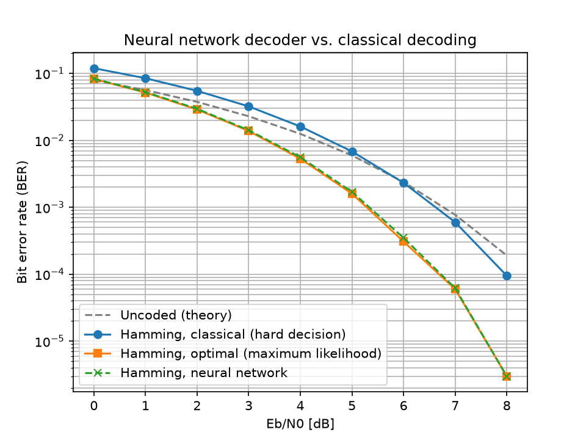

# 6G Link Simulation

A step-by-step Python simulation of a digital radio link: from uncoded BPSK over an AWGN channel to a neural-network decoder for a Hamming(7,4) code.

## Motivation

Channel coding lets a receiver reach a target bit error rate at a lower signal-to-noise ratio. Every dB saved means less transmit power for the same reliability, which matters for energy-efficient networks. For 6G, machine learning is being studied as a building block of the physical layer, for example as a learned decoder. This project builds the classical reference chain first and then checks how close a small neural network gets to the optimal decoder.

All simulations use Monte Carlo transmission of 10^6 (data) bits per Eb/N0 point with fixed random seeds, so results are reproducible.

## Stage 1: BPSK over AWGN



Random bits are mapped to BPSK symbols (±1), disturbed by additive white Gaussian noise and detected with a threshold at zero. The simulated BER matches the theoretical curve 0.5·erfc(√(Eb/N0)) over the whole range from 0 to 10 dB.

## Stage 2: QPSK over AWGN



Two bits are mapped to one complex Gray-coded QPSK symbol, and I and Q are detected independently. As expected, the BER per Eb/N0 is the same as for BPSK, while twice as many bits are sent per symbol. The right plot shows the received constellation at Eb/N0 = 8 dB.

## Stage 3: Channel coding with Hamming(7,4)



Each block of 4 data bits is encoded into a 7-bit codeword, sent with BPSK and hard-decided at the receiver. Single-bit errors are corrected with a syndrome lookup table. The noise is scaled by the code rate R = 4/7, so the comparison uses equal energy per data bit. With hard-decision decoding, the code only outperforms uncoded BPSK above about 6 dB. At BER = 1e-4 the gain is about 0.4 dB.

## Stage 4: Neural network decoder



A multilayer perceptron (7 → 64 → 64 → 16, PyTorch) receives the 7 unquantized channel outputs and classifies them into one of the 16 possible messages. It is trained only at Eb/N0 = 4 dB (3,000 Adam steps, batch size 1024). It is compared with:

- **Hard decision + syndrome decoding** (stage 3)
- **Maximum-likelihood (ML) decoding**: choose the codeword with the largest correlation with the received vector. This is optimal for this code on the AWGN channel.

The neural network follows the ML curve closely over the full range from 0 to 8 dB, including SNRs it was not trained on.

## Key results

Values at BER = 1e-4, linearly interpolated on the log-BER scale from the simulated points:

| Decoder | Required Eb/N0 | Gain vs. hard decision |
|---|---|---|
| Uncoded BPSK (theory) | 8.40 dB | – |
| Hamming(7,4), hard decision + syndrome | 7.97 dB | – |
| Hamming(7,4), maximum likelihood | 6.69 dB | 1.28 dB |
| Hamming(7,4), neural network | 6.72 dB | 1.25 dB |

- The neural network decoder reaches maximum-likelihood performance within about 0.04 dB at BER = 1e-4. Its BER stays within a few percent of the ML decoder at all tested SNRs.
- Soft-decision decoding (ML or neural network) gains about 1.3 dB over classical hard-decision decoding, and about 1.7 dB over uncoded BPSK.
- Limitation: with 10^6 bits per point, BER values below ~1e-5 are based on only a few bit errors and are statistically uncertain.

## Installation

Requires Python 3.10 or newer.

```bash
git clone https://github.com/king-john-1320/6g-link-simulation.git
cd 6g-link-simulation
python -m venv .venv
source .venv/bin/activate      # Windows: .venv\Scripts\activate
pip install -r requirements.txt
```

## Usage

Each stage is a standalone script. Figures are saved to `figures/`:

```bash
python 01_bpsk_awgn.py
python 02_qpsk_awgn.py
python 03_hamming_awgn.py
python 04_ml_decoder.py
```

Add `--no-show` to save the figures without opening a plot window (for example on a server or in CI):

```bash
python 04_ml_decoder.py --no-show
```

Each script runs in a few seconds on a laptop CPU.

## Project structure

```
6g-link-simulation/
├── 01_bpsk_awgn.py       # Stage 1: BPSK over AWGN
├── 02_qpsk_awgn.py       # Stage 2: QPSK over AWGN + constellation
├── 03_hamming_awgn.py    # Stage 3: Hamming(7,4) with syndrome decoding
├── 04_ml_decoder.py      # Stage 4: neural network vs. hard-decision vs. ML decoder
├── figures/              # generated plots
├── requirements.txt
└── README.md
```
